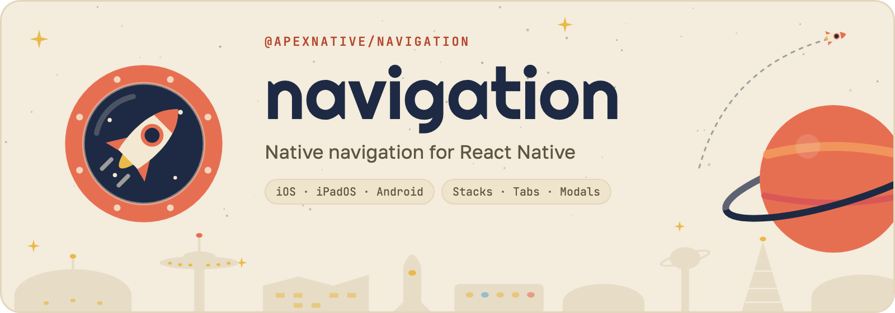

<picture>
  <source media="(prefers-color-scheme: dark)" srcset=".github/assets/navigation-banner-dark.png">
  
</picture>

# @apexnative/navigation

Native navigation for React Native on iOS, iPadOS and Android. Stacks, tabs, modals, side
menus and overlays are real platform containers — `UINavigationController`,
`UITabBarController`, Material components — owned by the native side and driven from JS.

> **Status:** a pre-release on npm; the API can still change before 1.0. The current version is on the
> [releases page](https://github.com/apexnative/navigation/releases).

## Principles

- **The platform leads.** Native stacks, tabs, sheets and gestures rather than a web-style
  router; a URL is one entry point among push notifications, widgets and shortcuts.
- **Native is the source of truth.** Navigation state, screen lifecycle, safe areas, keyboard
  and theme come from the OS.
- **App lifecycle is first-class.** Cold start, splash, session restore, background and
  process death are explicit steps.
- **New OS features, fast.** Support for new iOS and Android releases lands with the betas.
- **Customization without losing native behavior.** Options on system components first, your
  own native components inside native containers next, custom JS UI only as a last resort.
- **Performance is a requirement.** Transitions and gestures run natively; JS stays off the
  critical path, and we measure it in CI.

## Platforms

iOS, iPadOS and Android, on React Native 0.85 or newer with the New Architecture. The web is not a target.

## Installation

```sh
npm install @apexnative/navigation
npx apex-navigation setup
```

`setup` shows what it changes in the app and asks before writing, then installs the pods on a Mac:

- `MainApplication.kt` extends `NavigationApplication`, which loads React Native itself.
- `MainActivity.kt` extends `NavigationActivity`.
- `AndroidManifest.xml`: `android:enableOnBackInvokedCallback="true"`, so on the first screen the system plays its
  own back animation to the home screen (Android 16 turns it on for apps targeting SDK 36).
- `AppDelegate.swift` extends `ANNAppDelegate`, which creates the window and starts React Native.
- `Info.plist`: `UIViewControllerBasedStatusBarAppearance` is `true`, so each screen sets the status bar.
- `index.js` starts the app through the navigation; a new `Navigation.ts` shows `App` as the first screen.
- `navigation-env.d.ts` ties the commands to the screens of `Navigation.ts`, so names and props are checked.

`--dry-run` shows the changes without writing them, `--yes` applies them without asking, `--skip-pods` leaves
the pods for later. A file changed by hand stays as it is, and `setup` prints what to change in it. Expo apps
aren't supported by `setup` yet. A new app starts with `npx @apexnative/navigation init MyApp`.

`npx apex-navigation doctor` checks what the navigation needs in the app and on the machine: the files `setup`
sets up, the typed commands, React Native loaded twice, the screens and links of the app, JDK 17, the Android
SDK the app builds with, Xcode, CocoaPods, pods of an older navigation, a simulator and adb to run the app on,
another navigation in the app. Each problem comes with its fix; `--fix` makes the ones the CLI has, for errors
and warnings (`setup`, `links`, `icons`, `codegen`, `pod install`), asking before each, and `--json` prints the
checks for CI and tools. It exits with 1 when it finds an error.

The other commands: `screen` and `codegen` add screens, React or native; `links` declares deep links natively;
`icons` and `splash` make the app icon and the splash screen; `upgrade` upgrades the navigation; `migrate` moves
an app from another navigation library; `info` prints the versions for an issue; `mcp` serves
the commands and the docs to AI coding agents.

Edge-to-edge on Android follows the platform: always on Android 16+ for apps targeting SDK 36, and on
Android 15 for apps targeting SDK 35. With `edgeToEdgeEnabled=true` in `android/gradle.properties` (the
default of new React Native apps) it's on for every Android version.

## Contributing

See [CONTRIBUTING.md](CONTRIBUTING.md) and the [code of conduct](CODE_OF_CONDUCT.md).

## License

[MIT](LICENSE)
